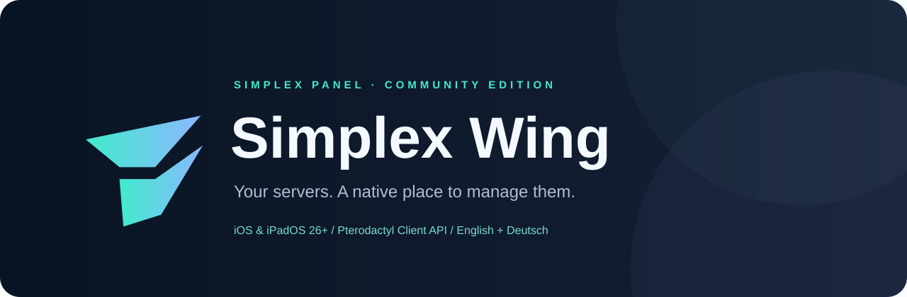

<p align="center"></p>

<p align="center">
  <a href="https://github.com/Robin9094707/Simplex-Panel/actions/workflows/ios.yml"></a>
  
  
  <a href="LICENSE"></a>
</p>

**Your servers. Your Wing.** Simplex Wing is the public **Simplex Panel · Community Edition**: a native SwiftUI workspace for Pterodactyl panels and hosting providers exposing a compatible Client API.

Connect your own panels, keep your credentials on your device, and manage servers from iPhone or iPad. Minecraft gets dedicated plugin, mod, configuration and player tools; other games retain the general server controls.

<p align="center"><a href="https://github.com/Robin9094707/Simplex-Panel/releases/latest"><strong>Download the latest IPA</strong></a> · <a href="docs/GETTING_STARTED.md">Getting started</a> · <a href="docs/COMPATIBILITY.md">Compatibility</a> · <a href="docs/PRIVACY.md">Privacy</a></p>

## A workspace that feels at home on iOS

- **Native interface:** translucent cards, system controls, adaptive layouts, light/dark appearance, customizable colors and alternate icons.
- **Guided setup:** choose English or German, connect your first panel or explore a safe demo. Change language later in Settings.
- **Multiple panels:** switch connections, pin favorite servers and folders, and arrange dashboard cards independently for each panel and server.
- **Live console:** Wings WebSocket authentication, reconnects, searchable output, chat/event/error filters, pause, scroll controls and the last 20 successfully sent commands.
- **Server health:** CPU, RAM, disk, network, uptime and resource history. Power actions respect server state and permissions.
- **File workspace:** folders, upload/download progress, background transfers, text and syntax editing, safe properties/YAML forms, move, rename, archive, extract and permissions.
- **Panel management:** backups and restores, schedules and tasks, database credentials, allocations, subusers, startup variables and account security.
- **Widgets and Live Activities:** resource snapshots with timestamps and visible stale states. Shared access depends on the signing profile; iOS controls background refresh.

## Minecraft, without a marketplace dependency

The app does **not** call Modrinth, Spigot/Spiget or CurseForge APIs. Bring your own legitimately obtained JARs through the iOS Files picker.

| Tool | What it does |
| --- | --- |
| Plugin library | Reads `plugin.yml` / `paper-plugin.yml` inside JARs, including name, version, main class, authors and dependencies. |
| Plugin installation | Checks metadata and duplicates, stages the upload, verifies SHA-256 and requires the server to be offline before installing. |
| Paper plugin updates | Compares installed and new identity/version, checks pending updates and the configured `bukkit.yml` update folder, then verifies the staged upload. Paper applies it on the next start. |
| Plugin state | Enable/disable a JAR for the next start, or delete its JAR with confirmation. Configuration folders are preserved. |
| Mod management | Reads Fabric, Quilt, Forge, NeoForge and supported legacy Forge metadata; checks identity/loader, rejects client-only mods, verifies uploads and backs up previous JARs outside `/mods`. |
| Configuration | Edit `server.properties`, YAML and world files with a text editor or conservative form fields. |
| Players | Parse `list` output, view names, inspect supported live values and review moderation/custom commands before sending. |
| NBT | Inspect Java NBT files, export drafts and apply changes offline with a verified backup. |

Metadata checks cannot prove full game, Java, loader or dependency compatibility. Marketplace discovery, automatic version lookup and premium account downloads are intentionally outside this edition. Read [Minecraft workflows](docs/MINECRAFT.md) before changing a production server.

## Install

1. Download the unsigned `.ipa` from [Releases](https://github.com/Robin9094707/Simplex-Panel/releases).
2. Sign it with your chosen sideloading tool and a valid signing identity, then install it.
3. Choose a language and add your HTTPS panel address plus a **Client API key**. Application/admin keys are rejected.

Requires **iOS / iPadOS 26 or later**. The bundle ID is `eu.simplexsmp.wing`, so this edition can coexist with the private Simplex Panel app. No companion plugin, relay server or app-owned cloud account is required. Never post panel keys in issues or screenshots.

Widgets need app/extension entitlements preserved by your signing service. See the [signing guide](docs/SIDELOADING.md) for App Groups and manual snapshot fallback. Live Activities refresh while the app is active; continuous closed-app updates are not included.

## Build from source

Use a Mac with Xcode containing the iOS 26 SDK or newer, Python 3 and [XcodeGen](https://github.com/yonaskolb/XcodeGen).

```sh
python3 scripts/icons.py
python3 scripts/validate.py
xcodegen generate
open Panel.xcodeproj
```

Choose your development team for both targets before device installation. The [GitHub Actions workflow](.github/workflows/ios.yml) runs isolation checks, focused unit tests and a simulator onboarding test, builds arm64, verifies the package and publishes the unsigned IPA only after those checks pass. Failed builds retain logs and test attachments for diagnosis.

```
Panel/          App, API client, server and Minecraft interfaces
Shared/         Models, language catalog, widget storage and signing support
PanelWidgets/   Home Screen widgets and Live Activities
PanelTests/     API boundaries, metadata and data integrity checks
PanelUITests/   First-run language and demo workflow
Config/         Entitlements; generated Info.plists are not checked in
scripts/        Reproducible icons and community boundary validation
docs/           Setup, compatibility, privacy and contributor guidance
```

## Scope and affiliation

Simplex Wing is an **independent community client**, not an official Pterodactyl product. Pterodactyl and other product names belong to their respective owners. The app uses its own Simplex identity and artwork. Provider availability, API permissions, proxy rules and file limits determine which actions work. Compatibility is based on Pterodactyl's stable 1.x Client API; modified panels and future API versions require verification. No blanket provider certification is implied.

Contributions are welcome. Read [CONTRIBUTING](CONTRIBUTING.md), [SECURITY](SECURITY.md) and the [MIT license](LICENSE).
